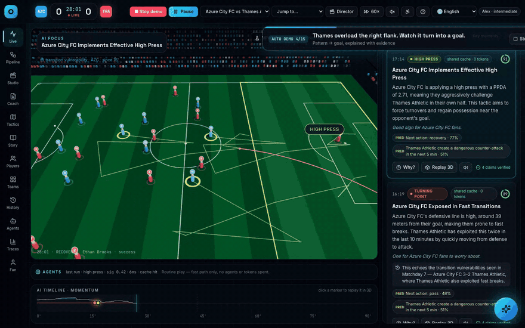
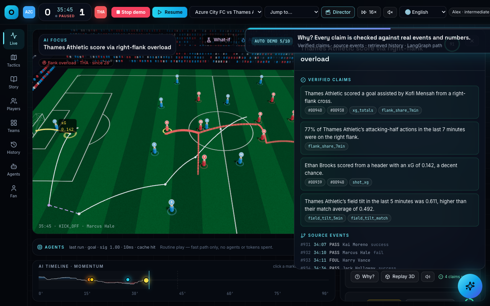
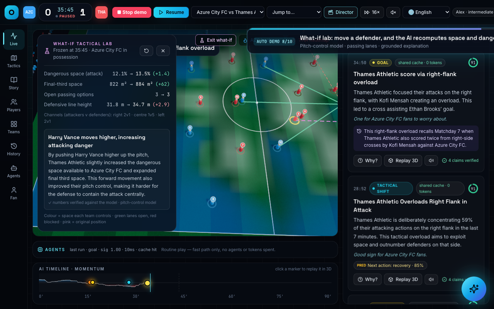
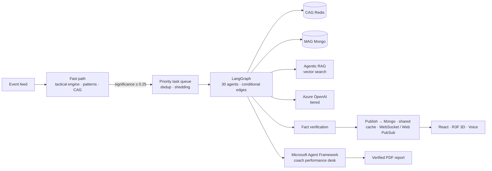
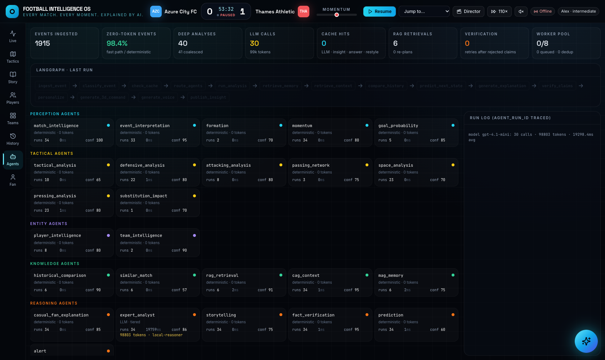
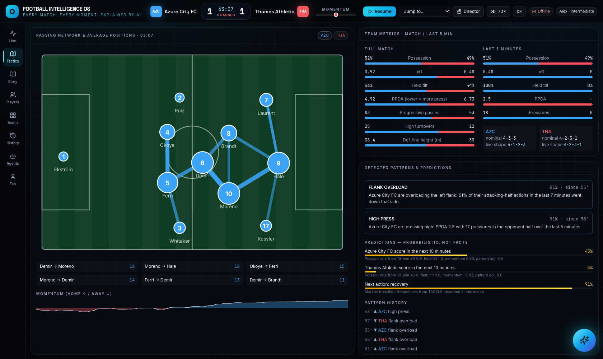
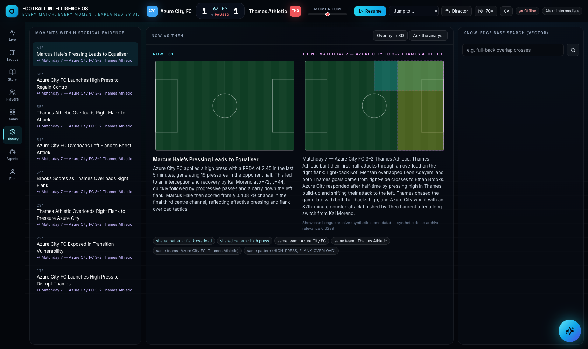
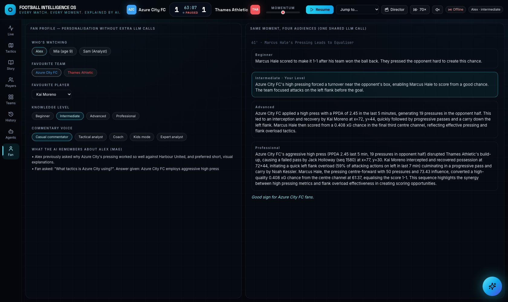

# ⚽ Football Intelligence OS

**Every Match. Every Moment. Explained by AI.**

A real-time, multi-agent football intelligence platform. It turns raw match events into tactical
understanding, verified explanations, predictions, 3D visualization, voice and personalized fan
experiences. Built on **LangGraph**, **FastAPI**, **MongoDB vector search** and **Azure OpenAI / Microsoft Foundry**.

**[🌐 Live demo: http://20.3.128.102:8061](http://20.3.128.102:8061)** · **[▶ 2-minute demo video](docs/video/fios-2min-v3.mp4)** · **[Full walkthrough (every agent)](docs/video/fios-full-v3.mp4)** ·
**[Pitch](docs/PITCH.md)** · **[Evaluation report](docs/EVALUATION.md)** · **[Architecture](docs/ARCHITECTURE.md)**



> **Data:** the product runs on **synthetic, football-realistic data** produced by our own match generator
> (fictional clubs *Azure City FC* vs *Thames Athletic*, 22 tracked players, ~2,300 events per match), as the
> hackathon requires. Real data is never shipped or used by the product.

## For judges: running in 60 seconds

Fastest: open the **live demo at http://20.3.128.102:8061** (no install). To run it locally:

```bash
git clone https://github.com/Ibtasamali/football-intelligence-os.git && cd football-intelligence-os
./run.sh          # installs on first run, starts backend :8077 + website :5188, opens the browser
```

1. A **60-second tour** opens on the first visit. Then press **✦ Auto Demo** and everything plays hands-free.
2. Or drive it yourself: **Kick off** → click any insight's **Why?** → ask the **Copilot** (bottom right) a question →
   open **Studio**, **Coach** and **Traces** in the left menu.
3. No Azure keys? It still runs: deterministic fallbacks replace the LLM prose and the browser voice replaces Azure
   neural voices. Add keys to `backend/.env` (template in `.env.example`) for the full experience.

Needs Python 3.11 and Node 20+. MongoDB and Redis are optional (in-memory fallbacks).

## What it does

| | |
|---|---|
| **Watches** | Every event (pass, press, shot, sub…) with 22-player positions enters an event pipeline over WebSockets |
| **Understands** | A deterministic tactical engine computes xG, PPDA, field tilt, line height, passing networks, momentum, and so on |
| **Detects** | Pattern detectors find *high press*, *flank overload*, *deep block*, *transition vulnerability* from the data alone |
| **Reasons** | A LangGraph router wakes only the agents that matter, chooses CAG / MAG / Agentic RAG, and tiers the model |
| **Verifies** | A Fact Verification agent rejects any claim whose numbers, events or sources aren't in the evidence |
| **Explains** | One LLM call produces beginner → professional explanations, broadcast line and voice scripts, shared by every fan |
| **Shows** | The 3D stadium highlights the zone, players, passing lanes and replays the sequence behind each insight |
| **Talks** | Hands-free voice conversation; 14 languages with native Azure neural voices |

### Measured, not claimed ([full report](docs/EVALUATION.md))

| Question | Result |
|---|---|
| Hallucination | Unsupported/contradicted claims **58% → 11%** vs a naive chatbot prompt; Foundry groundedness ≥ 4 on **100%** of pipeline texts; untraceable numbers **0%** (independent judge) |
| Cost | **≈ $0.05 of LLM per match**: 25 calls for 2,344 events; **98.9%** of events use no LLM |
| Tactical detection | Precision **63%**, recall **77%** on 30 unseen synthetic matches with known ground truth |
| Translation | **92%** of translations pass number/name re-verification |
| Fast path | 2.4 ms per event (p50) |
| Tests | 47 passing (`pytest`) |

| Explainable insight (Why?) | What-if lab |
|---|---|
|  |  |

### Three ways judges can play with it

- **60-second judge tour**: opens automatically on the first visit (replay any time with the `?` button).
- **✦ Auto Demo**: one click plays the whole story hands-free with captions and narration.
- **What-if lab**: freeze any moment, drag a player in 3D, and a pitch-control model recomputes who owns the space,
  the dangerous space, the open passing lanes and the defensive line; the AI explains the change with verified numbers.
- **Live conversation**: hands-free voice. Just talk; it answers out loud and listens again (interrupt with Space).

### For studios, accessibility and developers

- **Recap Studio** (Studio tab): one click writes a social post, push notification, broadcast lower-third, newsletter
  and a **two-host podcast** voiced by two Azure neural voices, in any of the 14 languages. Every format is
  fact-checked, and failing fields are corrected automatically. Export as JSON.
- **Accessibility mode** (♿ button, top bar): live audio description of goals, shots, cards and tactical changes for
  blind and low-vision fans, plus a screen-reader live region, high contrast, large text, reduced motion and keyboard
  shortcuts (`D` describe the pitch · `P` play/pause · `W` explain the latest moment · `H` help).
- **Coach report** (Coach tab): a real **Microsoft Agent Framework** workflow hands verified evidence through an
  evidence analyst, coach strategist, verifier and PDF publisher. The result includes actionable training priorities
  and a downloadable evidence appendix; unsafe prose fails closed to deterministic facts.
- **Tracing dashboard** (Traces tab): a metadata-only OpenTelemetry waterfall with errors and p50/p95 latency. The
  same spans export to Azure Application Insights; prompts and answers are never captured.
- **A2A agent**: `GET /.well-known/agent-card.json` and JSON-RPC `POST /a2a` (A2A 0.3 `message/send` and A2A 1.0
  `SendMessage`, so Microsoft Agent Framework's `A2AAgent` can call it) with the skills `match_qa`,
  `match_status` and `recap`, so other agents can call it. Try it with `backend/scripts/a2a_client.py`.
- **MCP server for GitHub Copilot**: `backend/mcp_server.py` has 8 tools (`ask_match`, `what_if`, `generate_recap`,
  `get_tactics`, …). Open the repo in VS Code and Copilot agent mode picks it up from `.vscode/mcp.json`.
- **Microsoft Foundry evaluators**: the evaluation harness scores every answer with `azure-ai-evaluation`
  (GroundednessEvaluator, RelevanceEvaluator) on top of our own fact verification.

### 14 languages

Insights are translated **after** fact verification, re-verified (no number may change; player names intact), cached
once per language for every fan, and read by a **native Azure neural voice**: English, Español, Français, Português,
Deutsch, Italiano, Nederlands, العربية, اردو, हिन्दी, Türkçe, 日本語, 한국어, 中文. Arabic and Urdu render right-to-left.
Fans can also *ask* in their language.

## Quick start

Prerequisites: Python 3.11, Node 20+, MongoDB and Redis on localhost (both optional; the app falls back to in-memory).

```bash
cp backend/.env.example backend/.env      # add Azure keys (optional: runs on local adapters without them)
./run.sh                                  # backend :8077, frontend :5188
```

Open **http://localhost:5188** and press **✦ Auto Demo** (full story, about 4 minutes), **🎬 2-min video** (the
submission-video cut), or **START MATCH** to drive it yourself. Add `?lang=ur` (or `es`, `ar`, …) for another language.
Before presenting, double-click **`PREPARE DEMO.command`** once so every insight is cached (instant and free).
API docs: http://localhost:8077/docs.

Docker: `docker compose -f infra/docker-compose.yml up --build` → http://localhost:8080
Azure: `./infra/azure/deploy.sh <resource-group> eastus` (see [infra/azure](infra/azure)).

Tests: `cd backend && .venv/bin/python -m pytest -q`

## Architecture



Full design: [docs/ARCHITECTURE.md](docs/ARCHITECTURE.md) · API: [docs/API.md](docs/API.md) ·
5-minute demo: [docs/DEMO.md](docs/DEMO.md) · Pitch: [docs/PITCH.md](docs/PITCH.md)

## Screens

| Agent Control Center | Tactics |
|---|---|
|  |  |
| **Historical comparison (Agentic RAG)** | **Personalization (one call, four audiences)** |
|  |  |

Also: Match Story (5 moments, how it was won, player of the match, tactical battle, biggest miss),
Players (influence model, touch maps), Teams (head-to-head), WHY? explainability drawer, voice Match Copilot.

## Hackathon categories: where to look

| Category | Evidence in this repo |
|---|---|
| **Best Multi-Agent Orchestration** | 30 LangGraph agents with conditional routing (`backend/app/graph/builder.py`) · Microsoft Agent Framework workflow (`backend/app/services/agent_desk.py`) · A2A endpoint (`backend/app/api/routes_a2a.py`) · MCP server for GitHub Copilot (`backend/mcp_server.py`, `.vscode/mcp.json`) |
| **Best Use of Microsoft Foundry** | Azure OpenAI with tiered routing and JSON-mode output (`backend/app/llm/router.py`) · Foundry evaluators in `backend/eval/llm_eval.py` · results in [EVALUATION.md](docs/EVALUATION.md) |
| **Best Enterprise Solution** | Fact verification on every insight (`backend/app/agents/evidence.py`) · Recap Studio · coach PDF · accessibility mode · OpenTelemetry tracing (`backend/app/services/tracing.py`) · auth, rate limiting, audit log, Key Vault, Bicep (`infra/azure`) |
| **Azure Cloud Native** | Container Apps, Cosmos DB for MongoDB vCore, Azure Cache for Redis, Web PubSub, Key Vault, Application Insights (`infra/azure/main.bicep`) |

## Microsoft / Azure

| Service | Role |
|---|---|
| Azure OpenAI (Microsoft Foundry) | Tiered reasoning (`gpt-4.1-mini`, optional large deployment), JSON-mode structured output |
| Azure AI Speech | Neural TTS voice per persona and language, two-host recap podcast, audio description, STT endpoint |
| Azure AI Evaluation (Foundry) | Groundedness and relevance evaluators in `backend/eval/llm_eval.py` |
| Azure AI Document Intelligence | Scouting / opposition PDFs → chunked → RAG knowledge base (`POST /api/knowledge/upload`) |
| Azure Cosmos DB for MongoDB vCore | Primary store and HNSW vector index (`VECTOR_BACKEND=cosmos`) |
| Azure Cache for Redis | CAG live context, insight / answer / LLM response caches |
| Azure Web PubSub | Fan-out of insights to millions of subscribers |
| Azure Container Apps | Stateless API / worker replicas, autoscaled |
| Key Vault + Managed Identity | All secrets; none in code or images |
| Application Insights | OpenTelemetry traces and logs |
| Microsoft Entra ID | JWT auth, tenant isolation (`AUTH_JWT_ISSUER`) |

## Data honesty

All product data is **synthetic**: fictional clubs, players and season archive, labelled synthetic in the UI. Live
provider feeds can plug in through `POST /api/events` (same schema). The API accepts only synthetic matches.

## Repository

```
backend/app   agents · graph · rag · cag · mag · tactical · prediction · voice · visualization · services · api
backend/tests 47 tests: tactics, patterns, routing, personalisation, RAG/CAG/MAG, verification, translation, LangGraph, API + WebSocket, voice
backend/eval  evaluation scripts → docs/EVALUATION.md
frontend/src  React + TypeScript + Tailwind + Framer Motion + React Three Fiber
infra         docker-compose, Azure Bicep + deploy script
docs          architecture, API, demo script, pitch deck content
```
