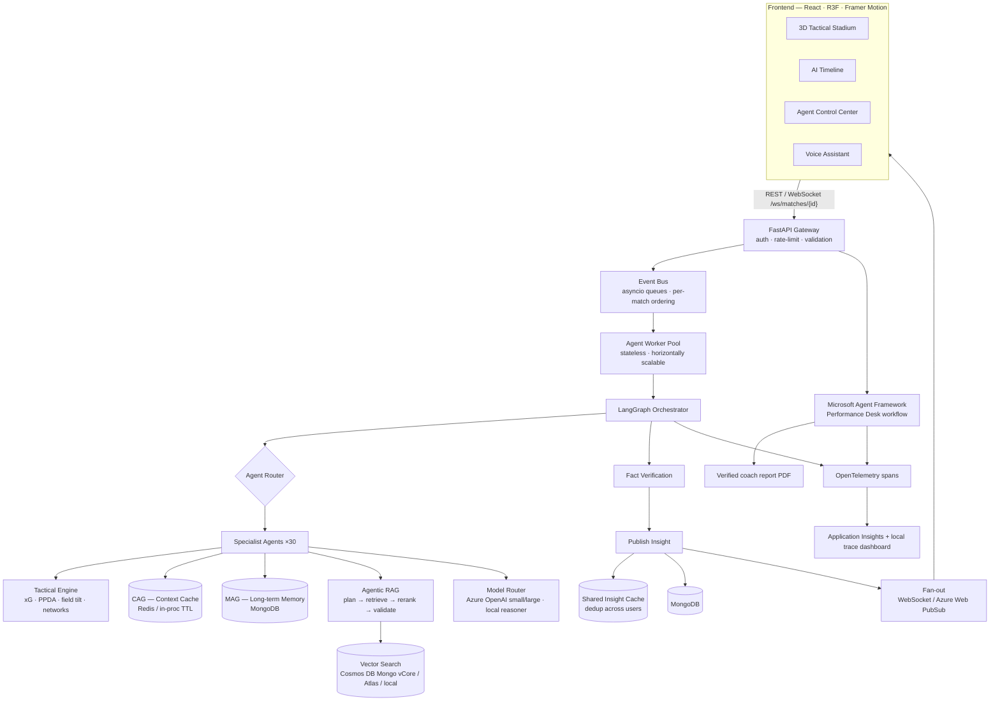
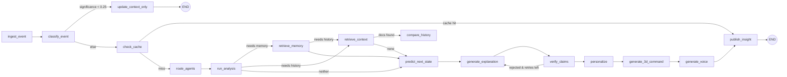

# Football Intelligence OS — System Architecture

> *Every Match. Every Moment. Explained by AI.*

## 1. Design principles

1. **Compute first, generate second.** Every number the AI says comes from the tactical engine
   (deterministic code over event data). LLMs only *phrase* and *reason over* evidence; they never
   invent statistics.
2. **Not every event deserves an LLM.** A significance scorer and an agent router decide, per event,
   which agents run and which model tier is used (`none` → `small` → `large`).
3. **Provenance on everything.** Each insight carries `source_events`, `retrieved_documents`,
   `agents_used`, `model`, `confidence`, `timestamp`. The UI's **WHY** button renders it.
4. **Refuse rather than fabricate.** The Fact Verification agent removes claims that reference
   unknown events or numbers that don't match the computed metrics. Low confidence returns
   "I don't have enough evidence to make a reliable conclusion."
5. **Every integration is an adapter.** LLM, embeddings, vector store, cache, speech, and
   realtime fan-out each have an interface, a local implementation, and an Azure implementation.

## 2. Runtime topology



## 3. The LangGraph state machine

`FootballState` (see `backend/app/graph/state.py`) flows through a graph with **conditional edges**:



Key decisions inside the graph:

| Node | Decides |
|---|---|
| `classify_event` | Significance score (0–1) from event type, location, xG, momentum delta, pattern changes. Cheap rules, no LLM. |
| `check_cache` | Insight fingerprint `(match, event-window hash, persona)` → reuse an existing insight across users. |
| `route_agents` | Which agents, in which **parallel waves**, whether RAG/MAG are needed, which model tier. |
| `retrieve_context` | Agentic RAG: plans queries, picks collections, scores evidence, **re-plans once** (broadened, filters dropped) if weak. |
| `verify_claims` | Rejects claims that cite unknown events or mismatched numbers; loops back once. |

## 4. Agents

Agents are **templates** (stateless classes registered in `agents/registry.py`). A run is an
`agent_run_id`-tagged task executed by the worker pool. 30 agents in 6 families:

| Family | Agents |
|---|---|
| Perception | Match Intelligence, Event Interpretation, Formation, Momentum, Goal Probability |
| Tactical | Tactical Analysis, Defensive, Attacking, Passing Network, Space, Pressing, Substitution Impact |
| Entities | Player Intelligence, Team Intelligence |
| Knowledge | RAG Retrieval, CAG Context, MAG Memory, Historical Comparison, Similar Match |
| Reasoning | Prediction, Fact Verification, Expert Analyst, Casual Fan Explanation, Storytelling, Alert |
| Experience | Fan Personalization, Broadcast Commentary, Voice Narrator, 3D Visualization, Final Answer |

Perception and tactical agents are **deterministic** (zero tokens). Reasoning/experience agents use
the model router.

## 5. Retrieval & memory layers

| Layer | Holds | Store | Lifetime | Used when |
|---|---|---|---|---|
| **CAG** | score, formation, last 20 events, last-5-min metrics, momentum, active patterns, subs | Redis (fallback: in-proc TTL) | match duration, TTL 2h, versioned | every analysed event; avoids retrieval |
| **MAG** | team/player history, prior tactical patterns, fan preferences, past conversations | MongoDB `football_memories`, `fan_profiles` | permanent | entity recall, "like last time", personalization |
| **RAG** | historical matches, tactical pattern library, coaching knowledge | MongoDB + vector index | permanent | "compare", "similar", novel patterns |

**Agentic RAG pipeline:** `RetrievalPlanner` (decide if needed, which collections, k) →
multi-source retrieval → reranker (vector score × entity overlap × pattern match × recency) →
evidence validation (min score, coverage) → re-plan with broadened query if weak → synthesis.

## 6. Cost model

| Event class | Example | Path | Tokens |
|---|---|---|---|
| Routine (≈85%) | sideways pass | CAG update only | 0 |
| Notable (≈12%) | recovery in final third | deterministic agents + small model | ~400 |
| Major (≈3%) | goal, pattern shift | full graph + RAG + large model | ~2.5k |

Plus: insight cache shared across users (100 identical questions → 1 call), embedding cache,
per-node result cache.

## 7. Scale: "an elastic agentic architecture capable of orchestrating millions of AI tasks"

- Events are partitioned by `match_id` → ordering per match, parallelism across matches.
- Workers are stateless; state lives in CAG/Mongo, so Azure Container Apps scales replicas on queue
  length (KEDA).
- Fan-out is decoupled: one insight computed per persona per window, broadcast to N subscribers via
  Azure Web PubSub.
- Every run is traceable: `agent_runs` collection + Application Insights (OpenTelemetry).

## 8. Microsoft Azure mapping (each service earns its place)

| Concern | Azure service | Why |
|---|---|---|
| Reasoning models | **Azure OpenAI / Microsoft Foundry** (`gpt-4o-mini` small, `gpt-4o` large) | tiered model routing |
| Embeddings | Azure OpenAI `text-embedding-3-small` | RAG vectors |
| Primary DB + vector search | **Azure Cosmos DB for MongoDB (vCore)** | Mongo API + native vector index, one store |
| CAG | Azure Cache for Redis | sub-ms context reads |
| Realtime fan-out | **Azure Web PubSub** | millions of WebSocket subscribers |
| Compute | **Azure Container Apps** (KEDA autoscale) | stateless workers |
| Voice | **Azure AI Speech** (STT + neural TTS voices per persona) | commentary voices |
| Secrets | Azure Key Vault + Managed Identity | no keys in code |
| Identity | Microsoft Entra ID (JWT) | auth/tenant isolation |
| Telemetry | Application Insights | agent latency/token dashboards |

## 9. Repository layout

```
backend/app/
  main.py            FastAPI app, lifespan, middleware
  core/              config, logging, security, rate limit, errors
  api/               routes_* + websocket
  models/            domain dataclasses (events, insights)
  schemas/           API request/response models
  repositories/      Mongo data access
  services/          match service, event bus, simulator, broadcaster
  tactical/          metrics engine, xG, pattern detection
  prediction/        probabilistic next-state models
  cag/ mag/ rag/     context cache, memory, agentic retrieval
  llm/               model router + Azure OpenAI + local reasoner adapters
  agents/            30 agents + router + registry
  graph/             LangGraph state + nodes + builder
  voice/             intent detection, persona scripts, Azure Speech adapter
  visualization/     3D command generation
  workers/           worker pool
  data/              synthetic match + historical knowledge base
frontend/src/        React app (screens, 3D scene, stores)
infra/               Bicep for Azure, docker-compose
```

## 10. Hallucination control (defence in depth)

1. **Grounded inputs.** The LLM sees only an evidence package: event, recent events, pattern metrics, agent
   outputs, predictions, retrieved docs, memories, goal list, and the score *frozen at ingest time* (the deep path is
   asynchronous, so live state could otherwise drift).
2. **Structured output.** JSON mode, normalised to a strict schema (`normalize_narrative`).
3. **Verification.** Every claim's event IDs must exist; metric refs must exist; every number in every text field
   must be traceable to the evidence (with rounding and percentage tolerance); "Matchday N" must be retrieved or
   remembered; future events can't be stated as certainties; unknown person names are flagged.
4. **Self-correction.** On failure the graph loops back to `generate_explanation` with the issues as feedback (max 1).
5. **Substitution.** Fields still failing are replaced by the deterministic template counterpart; confidence drops.
6. **Refusal.** Fan answers below 0.45 confidence return *"I don't have enough evidence to make a reliable conclusion."*

## 11. Real data, calibration and evaluation

- **StatsBomb adapter** (`app/data/statsbomb.py`): converts StatsBomb Open Data (120×80, per-team frame) into our
  105×68 absolute frame, maps event types, keeps StatsBomb xG, and builds 22-player positions from **360 freeze frames**
  (≈63% of positions in the World Cup final are real tracking; the rest use a formation model).
- **Real historical archive** (`app/services/archive.py`): each team's earlier tournament matches are replayed through the
  tactical engine and summarised into `historical_matches` + team-tendency memories (no LLM, every number computed).
- **Threshold profiles**: `synthetic` (hand-set + supervised, chosen on validation seeds) and `statsbomb` (calibrated on
  32 real matches so each pattern fires in ≈7% of windows). Selected per match by `match.source`.
- **Fitted models**: xG and goal-threat are logistic models fitted on real matches (`app/prediction/fitted.json`).
- **Evaluation**: see [EVALUATION.md](EVALUATION.md) — every number is generated by `backend/eval/`.

## 12. Multilingual commentary

Translation happens **after** fact verification, so facts are fixed first. `Translator` (`app/voice/translate.py`)
re-verifies every translation (no number added or changed; decimals, percentages and years preserved; player names intact)
with one retry, otherwise falls back to verified English. One translation per insight per language is cached and shared by
all fans; Azure AI Speech uses a native neural voice per language (14 languages, RTL for Arabic and Urdu).

## 13. Known limits (honest)

- Real-match positions are partly modelled where the 360 camera does not see a player.
- Local embeddings are hashed n-grams (no embedding deployment was available). Set `AZURE_OPENAI_EMBEDDING_DEPLOYMENT`
  for semantic embeddings; re-indexing happens at startup.
- Agents in the deep path compute 5-minute windows relative to processing time; score and clock are frozen at ingest.
- The Bicep template has not been deployed or compile-checked yet (the Azure CLI wasn't available in the build environment).

## 14. Implementation roadmap

| Phase | Module | Status |
|---|---|---|
| 1 | Core config, models, Mongo repos, synthetic data | ✅ |
| 2 | Tactical engine (metrics, xG, patterns) | ✅ |
| 3 | CAG, MAG, Agentic RAG, vector search | ✅ |
| 4 | Agents + router + LangGraph | ✅ |
| 5 | Event bus, worker pool, WebSockets, APIs | ✅ |
| 6 | Voice + personalization + storytelling | ✅ |
| 7 | Frontend + 3D stadium | ✅ |
| 8 | Tests, Docker, Azure Bicep, docs, pitch | ✅ |
